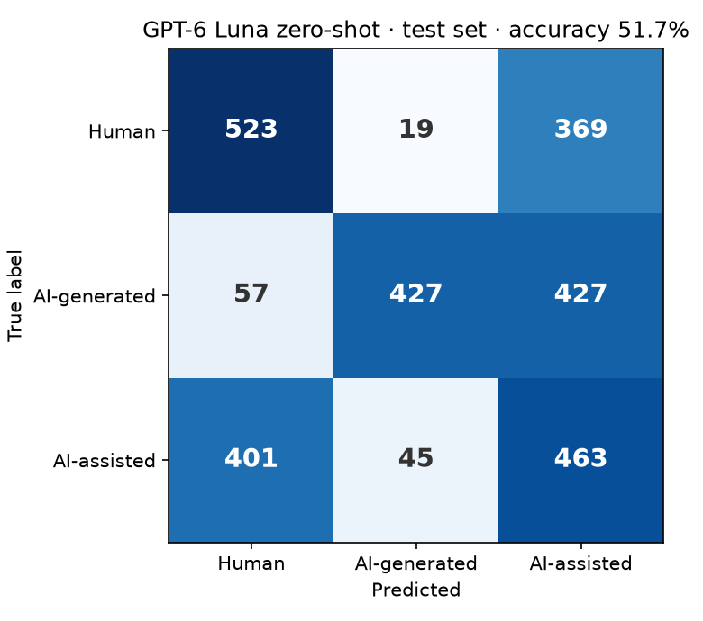

[← 04 · Hugging Face dataset](../04_hf-dataset/)

# 05 · Zero-shot LLM

Before training anything, the obvious question: **can an off-the-shelf LLM just do this?** We gave GPT-6 Luna each text from the test set, explained the three classes in the prompt, and asked it to classify the text. No training, no examples.

**Answer: no.** GPT-6 Luna gets **51.7%** right, not far above guessing (33%), and it wrongly flags **43% of human texts** as AI-written or AI-assisted.

## Output format

Everything is saved in `results/`:

| File | Content |
|---|---|
| `luna6-test-predictions.jsonl` | One line per text: `id`, `true_label`, `predicted_label`, the three probabilities, `word_count`, `generator_model`, token counts, and the error message if the request failed |
| `luna6-confusion-matrix.csv` / `.png` | Confusion matrix |
| `luna6-by-length.csv` | Accuracy and error per class for six length ranges |

The predictions file only holds IDs and labels, no texts. The texts are in the dataset.

## Setup

| | |
|---|---|
| Model | GPT-6 Luna (Azure OpenAI), reasoning set to `none` |
| Texts | The test set: the same 2,737 texts the trained models are tested on |
| Prompt | One short definition per class, then a JSON answer with a label and three probabilities. All classes equally likely before reading. |
| Cost | About **$0.30** for the whole test set (2.47M input tokens, 107K output tokens) |

6 texts from 3 topics (`328`, `3529`, `4937`) were blocked by Azure's content filter and are left out, so the results cover **2,731 texts** (911 human, 911 AI-generated, 909 AI-assisted).

## Results

| | Accuracy | Macro-F1 |
|---|---|---|
| GPT-6 Luna, zero-shot | **51.74%** | **52.97%** |

| True class | Correct | Error | Most common mistake |
|---|---|---|---|
| Human | 57.4% | 42.6% | called AI-assisted (369 of 911) |
| AI-generated | 46.9% | 53.1% | called AI-assisted (427 of 911) |
| AI-assisted | 50.9% | 49.1% | called human (401 of 909) |

**What the numbers show:**

- **"AI-assisted" is the model's catch-all.** It picks it 1,259 times for only 909 real AI-assisted texts. Whenever it's unsure, it lands there, and only 37% of those answers are right.
- **When it does say "AI-generated", it's usually right** (87% precision). But it says it rarely and misses more than half of the fully AI-written texts.
- **Human and AI-assisted look alike to it.** 369 human texts are called AI-assisted, and 401 AI-assisted texts are called human. That makes sense: an AI-assisted text is a human text with polished wording, so the content and structure are the same.
- **Even the simpler question fails.** As plain "human or AI?" (counting both AI classes as AI), it reaches 69.0%, and still flags 43% of human texts.

## Results by text length

| Words | Texts | Accuracy | Human error | AI-generated error | AI-assisted error |
|---|---|---|---|---|---|
| ≤70 | 399 | 56.9% | 14.2% | 37.3% | 78.6% |
| 71–150 | 293 | 43.0% | 39.4% | 60.7% | 72.7% |
| 151–300 | 637 | 49.5% | 38.8% | 57.8% | 54.0% |
| 301–500 | 342 | 52.6% | 46.2% | 46.1% | 49.0% |
| 501–750 | 652 | 52.3% | 57.8% | 59.7% | 27.5% |
| 750+ | 408 | 54.9% | 49.6% | 48.9% | 37.0% |

Length doesn't change how often the model is right (43–57% everywhere). It changes **which class it falls back on**. Short texts are mostly called human, so few humans are wrongly flagged, but almost all AI-assisted texts are missed. Long texts are more often called AI-assisted, so human error goes up to 58% and AI-assisted error goes down.

## Things we ran into

- **The prompt decides which mistake the model makes, not whether it makes one.** An earlier version without class definitions (tested on a different sample of 9,000 texts) answered "human" most of the time: it flagged only 5% of humans, but missed 48% of AI-generated and 77% of AI-assisted texts. With a definition for each class, it spreads its guesses more, and flags far more humans. Neither version is usable as a detector.
- **The content filter blocks some academic topics.** The same filter also refused some texts during generation (step 02). Retrying doesn't help, so these texts are reported as left out.
- **Stuck requests.** A few requests hung for minutes at the end of the run. The client now gives up after 60 seconds and the notebook retries, and every answer is saved right away, so a run can be stopped and resumed.

## Why this matters

A detector that wrongly accuses 4 in 10 human writers can't be used on real student or researcher texts. An LLM that writes fluent German still can't reliably tell its own kind of writing apart from human writing just by being asked. That's the reason for the next steps: training models on the dataset.

## How to run

Put `AZURE_API_KEY`, `AZURE_BASE_URL` and `AZURE_LUNA6_DEPLOYMENT` in the `.env` file in the repo root, then open `zero_shot_luna6.ipynb` and run the cells. The test set is read from `data/hf-dataset/`, built in step 04 (the dataset is private on Hugging Face, so it isn't in this repo). For a cheap test, set `LIMIT = 30` first. The full test set costs about $0.30. Running the Run cell again only retries missing or failed texts.

---

[← 04 · Hugging Face dataset](../04_hf-dataset/) -- [06 · TF-IDF baseline →](../06_tfidf-baseline/)
