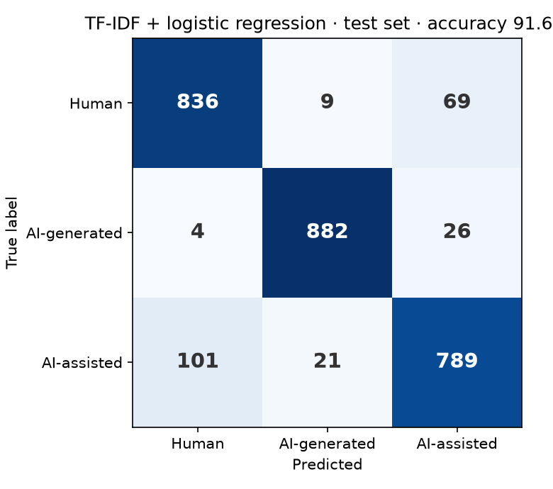

[← 05 · Zero-shot LLM](../05_zero-shot-llm/)

# 06 · TF-IDF baseline

The simplest model that actually learns from the data: turn each text into word and word-pair counts (TF-IDF) and train a logistic regression on them. It trains in a few minutes on a normal CPU, and every model after this one has to beat it.

**Result: 91.6% accuracy on the test set**, up from 51.7% for the zero-shot LLM in step 05. Human texts wrongly flagged as AI drop from 42.6% to **8.5%**.

## Output format

Everything is saved in `results/`:

| File | Content |
|---|---|
| `tfidf-tuning.csv` | Validation accuracy for every setting that was tried |
| `tfidf-test-predictions.csv` | One row per test text: `id`, `true_label`, `predicted_label`, the three probabilities, `word_count` (no texts) |
| `tfidf-confusion-matrix.csv` / `.png` | Confusion matrix |
| `tfidf-by-length.csv` | Accuracy and error per class for six length ranges |
| `tfidf-top-features.csv` | The 20 words that push hardest towards each class |

The trained model (about 5 MB) is saved locally to `models/tfidf-logreg/` and published on the Hugging Face Hub with a model card: [aliissa824/german-academic-ai-text-tfidf](https://huggingface.co/aliissa824/german-academic-ai-text-tfidf).

## Tuning

All settings were compared on the **validation set**. The test set was used only once, for the final result.

| Features | C = 1 | C = 3 | C = 10 | C = 30 |
|---|---|---|---|---|
| Single words (69,876 features) | 90.36% | 91.05% | 91.16% | 91.16% |
| Words + word pairs (200,000 features) | 91.02% | 91.33% | 91.47% | **91.71%** |

Word pairs help a little, and weaker regularisation (higher C) helps a little. The best setting is at the edge of the search and still slowly rising, so a bigger C or more features might add a few tenths of a percent. That's not enough to change the picture.

## Results

| Split | Accuracy |
|---|---|
| Train | 99.98% |
| Validation | 91.71% |
| **Test** | **91.60%** (macro-F1 91.59%) |

The model almost memorises the training set, which is normal for this setup. What matters is that validation and test agree closely, so the result holds on unseen texts.

| True class | Correct | Error | Most common mistake |
|---|---|---|---|
| Human | 91.5% | 8.5% | called AI-assisted (69 of 914) |
| AI-generated | 96.7% | 3.3% | called AI-assisted (26 of 912) |
| AI-assisted | 86.6% | 13.4% | called human (101 of 911) |

As plain "human or AI?" (both AI classes counted as AI), it reaches **93.3%**.

**What the numbers show:**

- **AI-generated text is the easy class.** Only 3.3% are missed, and almost never as human (4 of 912).
- **Human vs. AI-assisted is where the model struggles.** 170 of its 230 mistakes (74%) are these two classes mixed up. That's expected: an AI-assisted text keeps the human's content and structure, and only the wording changes.

## Results by text length

| Words | Texts | Accuracy | Human error | AI-generated error | AI-assisted error |
|---|---|---|---|---|---|
| ≤70 | 399 | 77.7% | 19.4% | 11.9% | 35.9% |
| 71–150 | 293 | 91.8% | 9.6% | 1.6% | 16.9% |
| 151–300 | 640 | 93.1% | 8.7% | 2.9% | 10.1% |
| 301–500 | 342 | 94.7% | 4.7% | 2.2% | 7.5% |
| 501–750 | 653 | 94.9% | 4.7% | 1.0% | 8.7% |
| 750+ | 410 | 94.6% | 6.4% | 0.8% | 8.6% |

Short texts are clearly harder: with 70 words or fewer, there are simply too few words to count. From about 150 words on, accuracy levels off around 93–95%.

## Which words decide?

A logistic regression gives every word a weight per class, so you can see what it learned. The strongest words for each class (from `tfidf-top-features.csv`):

| Human | AI-generated | AI-assisted |
|---|---|---|
| aber, so, hier, bzw, schon, dann, also, immer, bisher | zugleich, institutionelle, bleibt, verbindet, sichtbar, ergänzend, systematisch, entscheidend, bildet, entsteht | jedoch, sowie, etwa, beispielsweise, hingegen, darüber hinaus, beziehungsweise, insbesondere, zudem, lediglich |

- **Human writing uses short, plain connectors:** *aber, so, dann, also, schon*, and abbreviations like *bzw*.
- **AI-assisted texts swap those for formal ones:** *jedoch, sowie, hingegen, darüber hinaus, zudem*. The clearest example is *bzw* in human texts and the written-out *beziehungsweise* in the AI-polished versions of the same texts. That's what polishing looks like at the word level.
- **AI-generated texts use abstract, "summarising" vocabulary:** *zugleich, sichtbar, systematisch, entscheidend*, and verbs like *verbindet, bildet, entsteht*.

This also shows the limit of the approach: the model only sees which words appear, not how sentences are built. A human who writes formally, or an AI told to write plainly, can fool it. The next step uses models that read the whole text in context.

## How to run

Put `HF_TOKEN` in the `.env` file in the repo root (the dataset is private on Hugging Face), then open `tfidf_baseline.ipynb` and run the cells. No GPU is needed; it takes about 5–10 minutes on a normal CPU. The "Try it" cell runs the model on your own text, and the last cell uploads it to Hugging Face (set `UPLOAD = True`).

---

[← 05 · Zero-shot LLM](../05_zero-shot-llm/) -- [07 · Fine-tuning →](../07_fine-tuning/)