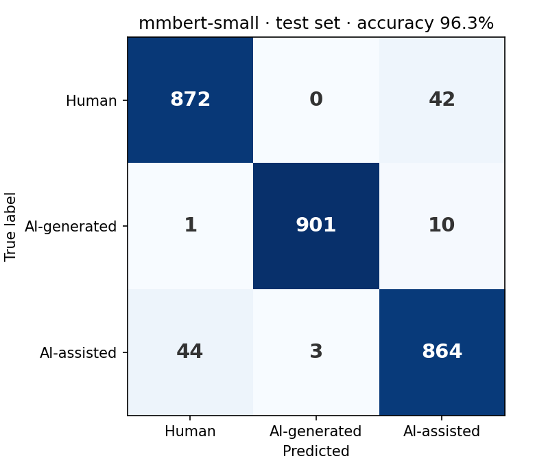

[← 06 · TF-IDF baseline](../06_tfidf-baseline/)

# 07 · Fine-tuning

Five pretrained transformer models, fine-tuned on the dataset from step 04 with the same data, settings and evaluation. Unlike TF-IDF, they read words in context.

**Result: the best models get about 96–97% right**, up from 91.6% for TF-IDF. On this test set, mmBERT-small, mmBERT-base and GELECTRA-large are practically tied. On texts from new sources, tested by Hassan ([his step 14](https://github.com/HassanHijaze/german-ai-text-detector-from-scratch/tree/main/14_ood-model-comparison)), **mmBERT-base is the strongest model**: it keeps 96.6%, while mmBERT-small drops to 81%.

## Output format

Each model saves its results to `results/<model>/`: `summary.json` (main numbers), `test-predictions.csv`, `confusion-matrix.csv` / `.png`, `by-length.csv` and `by-generator.csv`. `results/all-models.csv` has all five models in one table. The models are on the Hugging Face Hub with their calibration: [mmBERT-small](https://huggingface.co/aliissa824/german-academic-ai-text-mmbert-small), [XLM-RoBERTa base](https://huggingface.co/aliissa824/german-academic-ai-text-xlm-roberta-base) and [DistilBERT German](https://huggingface.co/aliissa824/german-academic-ai-text-distilbert-german).

Ten real rows from `test-predictions.csv` (XLM-RoBERTa base). Texts with the same number belong together:

| id | true label | predicted | human | ai_generated | ai_assisted | words | generator |
|---|---|---|---|---|---|---|---|
| human-46 | human | **ai_assisted** ✗ | 0.039 | 0.014 | 0.947 | 52 | – |
| assisted-46 | ai_assisted | ai_assisted | 0.036 | 0.015 | 0.949 | 53 | gpt-5.6-luna |
| generated-46 | ai_generated | ai_generated | 0.013 | 0.904 | 0.083 | 44 | gpt-5.6-luna |
| human-2547 | human | human | 0.927 | 0.016 | 0.057 | 997 | – |
| human-5600 | human | human | 0.954 | 0.018 | 0.028 | 606 | – |
| assisted-5600 | ai_assisted | **human** ✗ | 0.918 | 0.018 | 0.064 | 609 | deepseek-flash |
| generated-5600 | ai_generated | ai_generated | 0.011 | 0.976 | 0.013 | 622 | deepseek-flash |
| human-7508 | human | human | 0.955 | 0.018 | 0.027 | 298 | – |
| assisted-7508 | ai_assisted | ai_assisted | 0.029 | 0.017 | 0.954 | 317 | gpt-6-luna |
| generated-7508 | ai_generated | ai_generated | 0.010 | 0.974 | 0.016 | 282 | gpt-6-luna |

## Models and settings

| Model | Size | Run by |
|---|---|---|
| [DistilBERT German](https://huggingface.co/distilbert/distilbert-base-german-cased) | ~66M | Ali |
| [mmBERT-small](https://huggingface.co/jhu-clsp/mmBERT-small) | ~140M | Ali |
| [XLM-RoBERTa base](https://huggingface.co/FacebookAI/xlm-roberta-base) | ~280M | Ali |
| [mmBERT-base](https://huggingface.co/jhu-clsp/mmBERT-base) | ~310M | Hassan |
| [GELECTRA-large](https://huggingface.co/deepset/gelectra-large) | ~335M | Hassan |

All models: learning rate 2e-5, 3 epochs, batch size 8, texts cut at 512 tokens. The best epoch is picked on the validation set; the test set is used once at the end.

## Results

| Model | Accuracy | Human error | AI-generated error | AI-assisted error |
|---|---|---|---|---|
| GPT-6 Luna, zero-shot (step 05) | 51.7% | 42.6% | 53.1% | 49.1% |
| TF-IDF (step 06) | 91.6% | 8.5% | 3.3% | 13.4% |
| DistilBERT German | 91.3% | 20.1% | 2.2% | 3.7% |
| XLM-RoBERTa base | 92.8% | 17.8% | 1.0% | 2.9% |
| mmBERT-small | 96.3% | **4.6%** | 1.2% | 5.2% |
| mmBERT-base | 96.6% | 5.6% | 1.0% | 3.5% |
| GELECTRA-large | **96.9%** | 4.7% | 1.5% | 3.1% |

- **Three models are practically tied at 96–97%:** mmBERT-small, mmBERT-base and GELECTRA-large.
- **Bigger isn't automatically better.** XLM-RoBERTa is twice the size of mmBERT-small but 3.6 points worse, and DistilBERT doesn't beat TF-IDF.
- **DistilBERT and XLM-RoBERTa wrongly flag 18–20% of human texts**, almost all as AI-assisted.
- **AI-generated text is easy** for every trained model. Most mistakes mix up human and AI-assisted texts.

## Checked with a second run

Hassan trained the same models with a different seed and on different hardware. For the three models we both ran, the results agree within 0.5–1.7 points:

| Model | Ali | Hassan |
|---|---|---|
| DistilBERT German | 91.3% | 90.8% |
| XLM-RoBERTa base | 92.8% | 91.1% |
| mmBERT-small | 96.3% | 95.7% |

So differences of about 1 point between models shouldn't be read as real.

## By text length

| Words | DistilBERT | XLM-R | mmBERT-small | mmBERT-base | GELECTRA-large |
|---|---|---|---|---|---|
| ≤70 | 86.0% | 84.7% | 88.0% | 89.5% | 90.7% |
| 71–150 | 91.5% | 92.5% | 96.2% | 96.6% | 97.3% |
| 151–300 | 91.1% | 94.2% | 96.7% | 96.9% | 97.7% |
| 301–500 | 94.2% | 94.2% | 98.8% | 99.4% | 98.2% |
| 501–750 | 93.0% | 94.9% | 98.3% | 98.5% | 97.9% |
| 750+ | 91.7% | 93.9% | 98.8% | 98.0% | 98.8% |

Short texts (≤70 words) are the hardest for every model. Above 300 words, the best models get 98–99% right.

## By AI model

Error on AI-assisted texts, by the model that rewrote them:

| Rewritten by | DistilBERT | XLM-R | mmBERT-small |
|---|---|---|---|
| GPT-5.6 Luna | 1.5% | 2.0% | 4.4% |
| Gemini 3.8 Flash | 1.6% | 2.4% | 2.0% |
| GPT-6 Luna | 3.4% | 1.5% | 3.4% |
| DeepSeek V4 Flash | **9.4%** | **6.3%** | **12.5%** |

DeepSeek's AI-assisted texts are missed far more often, and then called human. But DeepSeek also worked on different human texts (step 02), so step 09 checks whether it's the AI model or the source.

## Things we ran into

- **Overconfidence.** The models were too sure of themselves. Temperature scaling fixes this without changing any prediction: for mmBERT-small, it brought the validation log-loss from 0.326 down to 0.137. The temperature is saved with each model.
- **Three epochs isn't enough for every model.** DistilBERT and XLM-RoBERTa were still improving when training stopped; mmBERT-small had levelled off. Every model gets the same budget to keep the comparison fair.
- **About half the texts are longer than 512 tokens**, so the models only see their beginning. Long texts are still the most accurate, so the beginning seems to be enough.

## How to run

Open `fine_tuning.ipynb`, set `HF_TOKEN` in the `.env` file (the dataset is private on Hugging Face, so the token needs access to it), pick a model in `MODEL_KEY` and run all cells. It loads the dataset from the Hugging Face Hub, trains, calibrates, evaluates on the test set, uploads the model, and logs everything to MLflow.

---

[← 06 · TF-IDF baseline](../06_tfidf-baseline/) -- [08 · Learning curves →](../08_learning-curves/)