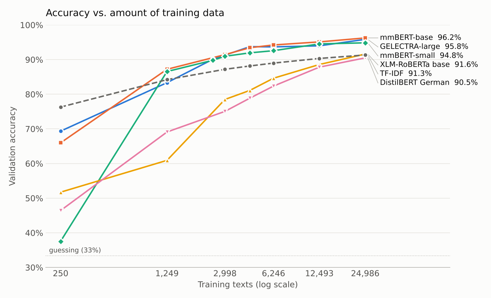

[← 07 · Fine-tuning](../07_fine-tuning/)

# 08 · Learning curves

How much training data does the detector need? Each model is trained again on growing parts of the training set, from 1% (250 texts) to 100% (24,986 texts), and tested on the validation set each time.

**Result:** with only about 3,000 training texts, the best transformers already reach what TF-IDF reaches with all 25,000. With all the data, they're still slowly improving, so more data would help a little, but not much.

## Output format

`results/learning-curves.csv` has one row per model and training size. Ten real rows:

| model | training_texts | training_fraction | training_accuracy | validation_accuracy |
|---|---|---|---|---|
| tfidf | 250 | 0.01 | 1.0000 | 0.7629 |
| tfidf | 24,986 | 1.00 | 0.9954 | 0.9133 |
| mmbert-small | 250 | 0.01 | 0.4040 | 0.3754 |
| mmbert-small | 1,249 | 0.05 | 0.9335 | 0.8655 |
| mmbert-small | 24,986 | 1.00 | 0.9759 | 0.9484 |
| mmbert-base | 250 | 0.01 | 0.7680 | 0.6597 |
| mmbert-base | 2,998 | 0.12 | 0.9636 | 0.9143 |
| mmbert-base | 24,986 | 1.00 | 0.9813 | 0.9625 |
| distilbert-german | 250 | 0.01 | 0.5120 | 0.4642 |
| distilbert-german | 24,986 | 1.00 | 0.9240 | 0.9050 |

`results/learning-curves.png` is the chart below.

## What the curves show

- **With very little data, TF-IDF wins.** With 250 texts it reaches 76%, while the transformers get 38–69%. mmBERT-small barely beats guessing: 250 texts are too few for it to learn anything in 3 epochs.
- **The mmBERT models overtake TF-IDF at about 1,250 texts**, GELECTRA-large at about 2,500. With about 3,000 texts, they're at 90–91%, about what TF-IDF reaches with all the data.
- **DistilBERT and XLM-RoBERTa need the most data.** They're still rising steeply at the end (+2.7 and +3.0 points from 50% to 100% of the data), so more data would help them most.
- **The best models are levelling off.** From 50% to 100% of the data, mmBERT-small gains only 0.3 points, mmBERT-base 1.1 and GELECTRA-large 1.9. Doubling the dataset again would probably add only around a point.

## Notes

- **Run by Hassan**, with a different seed and different hardware than step 07.
- **Same settings as step 07**, except that the model after the last epoch is kept (no best-epoch pick, no warm-up). That's why the 100% points are slightly lower than in step 07.
- **TF-IDF uses C = 3** here; step 06 found C = 30 slightly better (91.7% instead of 91.3% on validation).
- **The subsets are nested and balanced:** each one contains the smaller ones, and all three classes stay equally represented. The test set isn't used.

## How to run

Open `learning_curves.ipynb`, set `HF_TOKEN` in the `.env` file (the dataset is private on Hugging Face, so the token needs access to it), pick a model in `MODEL_KEY` and run all cells. Each run adds that model's rows to `results/learning-curves.csv`, and the last cell redraws the chart with all models. TF-IDF takes a few minutes; each transformer is trained seven times, so it takes much longer.

---

[← 07 · Fine-tuning](../07_fine-tuning/) -- [09 · Model comparison →](../09_model-comparison/)
