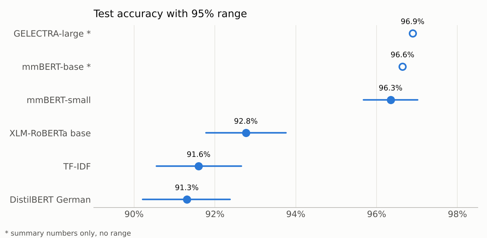
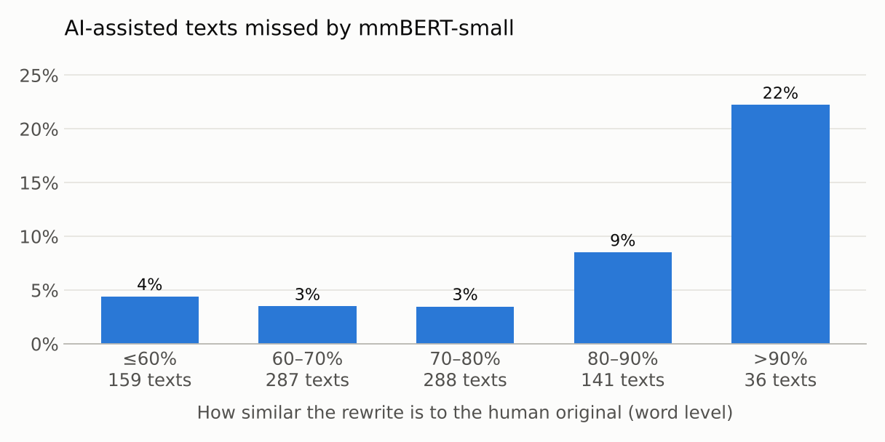

[← 08 · Learning curves](../08_learning-curves/)

# 09 · Model comparison

All models side by side on the same 2,737 test texts, using the saved predictions from steps 05–07. Three questions: which differences are real, why DeepSeek's texts are harder, and which texts fool every model.

**Result:** mmBERT-small, mmBERT-base and GELECTRA-large are clearly ahead of everything else on this test set. On texts from new sources, mmBERT-base is the strongest (see below). DeepSeek's AI-assisted texts are harder because DeepSeek changes less when it polishes, not because of where the texts come from.

## Output format

Everything is saved in `results/`:

| File | Content |
|---|---|
| `comparison.csv` / `.png` | Accuracy, 95% range and error per class for all models |
| `differences.csv` | Accuracy difference between pairs of models, with 95% range |
| `ai-assisted-error-by-generator-and-source.csv` | AI-assisted error per AI model and source |
| `rewrite-similarity.csv` / `missed-by-similarity.png` | How similar each AI-assisted text is to its original |
| `hard-texts.csv` | The 30 texts that all four models get wrong (IDs only) |

Ten real rows from `hard-texts.csv` (labels: 0 = human, 1 = ai_generated, 2 = ai_assisted):

| id | label | source | generator_model | word_count | mmBERT-small |
|---|---|---|---|---|---|
| human-2659 | 0 | ssoar | – | 42 | 2 |
| human-5040 | 0 | refubium | – | 43 | 2 |
| generated-1840 | 1 | ssoar | gpt-5.6-luna | 45 | 2 |
| human-46 | 0 | refubium | – | 52 | 2 |
| assisted-7366 | 2 | pedocs | deepseek-flash | 54 | 0 |
| assisted-9652 | 2 | ssoar | gpt-6-luna | 60 | 0 |
| human-8593 | 0 | ssoar | – | 141 | 2 |
| assisted-5829 | 2 | pedocs | deepseek-flash | 149 | 0 |
| assisted-6828 | 2 | pedocs | deepseek-flash | 599 | 0 |
| human-6923 | 0 | pedocs | – | 995 | 2 |

## All models

| Model | Accuracy | 95% range | Human error | AI-generated error | AI-assisted error |
|---|---|---|---|---|---|
| GPT-6 Luna, zero-shot | 51.7% | – | 42.6% | 53.1% | 49.1% |
| DistilBERT German | 91.3% | 90.2–92.4% | 20.1% | 2.2% | 3.7% |
| TF-IDF | 91.6% | 90.6–92.7% | 8.5% | 3.3% | 13.4% |
| XLM-RoBERTa base | 92.8% | 91.8–93.8% | 17.8% | 1.0% | 2.9% |
| mmBERT-small | 96.3% | 95.7–97.0% | **4.6%** | 1.2% | 5.2% |
| mmBERT-base * | 96.6% | – | 5.6% | 1.0% | 3.5% |
| GELECTRA-large * | 96.9% | – | 4.7% | 1.5% | 3.1% |

\* By Hassan; only summary numbers exist, so there's no range. The zero-shot LLM was tested on 2,731 texts (6 were blocked by the content filter).

The 95% range comes from resampling whole documents, because texts from the same document (and a human text and its AI partners) aren't independent.

## Which differences are real?

| Comparison | Difference (points) | 95% range | Real? |
|---|---|---|---|
| mmBERT-small vs. TF-IDF | +4.8 | +3.7 to +5.8 | yes |
| mmBERT-small vs. XLM-RoBERTa | +3.6 | +2.7 to +4.5 | yes |
| XLM-RoBERTa vs. DistilBERT | +1.5 | +0.5 to +2.5 | yes |
| XLM-RoBERTa vs. TF-IDF | +1.2 | +0.0 to +2.3 | barely |
| DistilBERT vs. TF-IDF | −0.3 | −1.6 to +1.0 | no, a tie |

mmBERT-small's lead over XLM-RoBERTa and TF-IDF is real. Between mmBERT-small, mmBERT-base and GELECTRA-large (about half a point apart), no difference can be shown on this test set: two runs of the same model already differ by up to 1.7 points (step 07).

## On texts from new sources

The test set above comes from the same academic sources as the training data. Hassan also tested his runs of all six models on 869 texts from German Wikinews, Wikipedia, Wikivoyage and Wikibooks ([his step 14](https://github.com/HassanHijaze/german-ai-text-detector-from-scratch/tree/main/14_ood-model-comparison)):

| Model | Accuracy | Human texts wrongly flagged |
|---|---|---|
| TF-IDF + logistic regression | 79.4% | – |
| mmBERT-small | 81.1% | 51.0% |
| DistilBERT German | 89.4% | 19.3% |
| XLM-RoBERTa base | 91.8% | 17.2% |
| GELECTRA-large | 96.3% | 7.2% |
| **mmBERT-base** | **96.6%** | **3.4%** |

This separates the three best models: mmBERT-base keeps its accuracy, while mmBERT-small wrongly flags half of the new human texts. **mmBERT-base is the strongest model of the project.**

## Why are DeepSeek's texts harder?

In step 07, all models missed DeepSeek's AI-assisted texts far more often. But DeepSeek mostly worked on peDOCS texts, so the source could have been the reason. Comparing within peDOCS only:

| Model | DeepSeek (183 texts) | GPT-6 Luna (73 texts) |
|---|---|---|
| TF-IDF | 29.5% | 8.2% |
| DistilBERT German | 9.3% | 1.4% |
| XLM-RoBERTa base | 6.6% | 1.4% |
| mmBERT-small | 13.1% | 2.7% |

Even on the same source, DeepSeek's texts are missed 3.5–7 times more often (significant for three of the four models). And human texts from peDOCS aren't flagged more often than others, so **it's the AI model, not the source**.

The likely reason: **DeepSeek changes less.** Its rewrites keep much more of the original wording (median similarity 0.84, against 0.66–0.72 for the others). And the more a rewrite keeps, the harder it is to catch:

This explains part of it, not all: even at the same similarity, DeepSeek's texts are still missed about twice as often.

## Texts that fool every model

30 test texts are wrong in all four models (TF-IDF, DistilBERT, XLM-RoBERTa, mmBERT-small):

- **19 human texts called AI-assisted** (by the three transformers; TF-IDF sometimes says AI-generated), 9 AI-assisted texts called human (8 of them by DeepSeek), and 2 AI-generated texts.
- **Mostly short:** 60% have 70 words or fewer, against 15% of the whole test set.

Very short, formal human writing and light AI polishing look the same to every model.

## How to run

Open `model_comparison.ipynb` and run all cells. It reads the saved predictions from steps 05–07 and the test set from the Hugging Face Hub (`HF_TOKEN` in `.env`; the dataset is private, so the token needs access to it). No training; it takes a few minutes.

---

[← 08 · Learning curves](../08_learning-curves/) -- [Back to overview →](../)