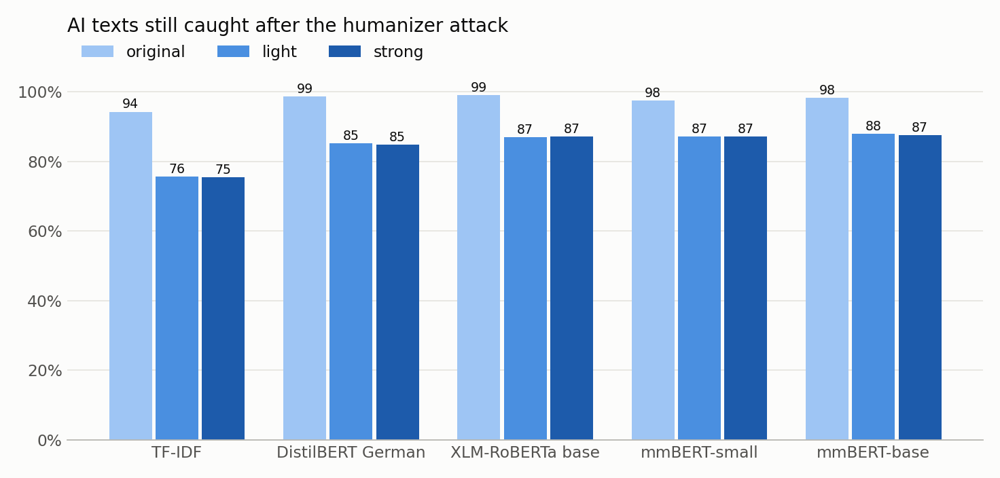
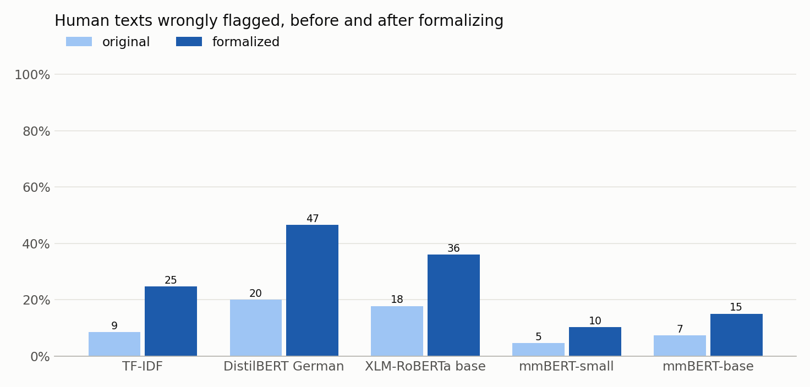

[← 09 · Model comparison](../09_model-comparison/)

# 10 · Humanizer attack

Can the detector be fooled by swapping a few words? The models partly rely on word choice (AI writes *jedoch*, humans write *aber*), so we swapped typical AI words for plain ones in the AI test texts, and did the reverse for the human texts.

**Result: swapping about five words lets one in four AI-assisted texts through, even with the best model. Human texts in formal style get flagged at least twice as often. AI-generated texts are not affected.**

## Output format

`results/` holds `attack-results.csv` (the numbers below), `predictions.csv` (every model's prediction per text and version, no texts) and the two charts. Ten real rows from `predictions.csv` (0 = human, 1 = AI-generated, 2 = AI-assisted):

| id | label | version | swaps | TF-IDF | DistilBERT | XLM-R | mmBERT-small | mmBERT-base |
|---|---|---|---|---|---|---|---|---|
| assisted-343 | 2 | original | 0 | 0 | 2 | 2 | 2 | 2 |
| assisted-343 | 2 | light | 2 | 0 | **0** | **0** | **0** | **0** |
| assisted-422 | 2 | original | 0 | 2 | 2 | 2 | 2 | 2 |
| assisted-422 | 2 | light | 3 | **0** | **0** | **0** | **0** | **0** |
| human-105 | 0 | original | 0 | 0 | 0 | 0 | 0 | 0 |
| human-105 | 0 | formalized | 5 | **2** | **2** | **2** | **2** | **2** |
| human-114 | 0 | original | 0 | 1 | 0 | 0 | 0 | 0 |
| human-114 | 0 | formalized | 1 | 1 | **1** | **1** | **1** | **1** |
| generated-47 | 1 | original | 0 | 1 | 1 | 1 | 1 | 1 |
| generated-47 | 1 | strong | 13 | 1 | 1 | 1 | 1 | 1 |

## The attack

| Version | Applied to | Swaps (`humanizer.py`) |
|---|---|---|
| **light** | AI texts | 15 typical AI words → plain ones: *jedoch* → *aber*, *beziehungsweise* → *bzw.*, *zudem* → *außerdem* |
| **strong** | AI texts | light, plus human abbreviations: *zum Beispiel* → *z. B.* |
| **formalized** | human texts | the reverse: *aber* → *jedoch*, *vor allem* → *insbesondere* |

On average, 5 words per AI text and 3 per human text were swapped. The content never changes.

## Results

| Model | AI-assisted caught: original → light | AI-generated caught: original → light | Human texts flagged: original → formalized |
|---|---|---|---|
| TF-IDF | 88.9% → 52.9% | 99.6% → 98.3% | 8.5% → 24.7% |
| DistilBERT German | 97.3% → 70.9% | 100% → 99.5% | 20.1% → 46.6% |
| XLM-RoBERTa base | 98.0% → 74.2% | 100% → 99.7% | 17.8% → 36.0% |
| mmBERT-small | 95.2% → 74.8% | 99.9% → 99.5% | 4.6% → 10.4% |
| mmBERT-base * | 96.4% → 77.0% | 100% → 98.8% | 7.3% → 15.1% |

\* Hassan's public model ([HassanHijazi/german-ai-text-mmbert-base](https://huggingface.co/HassanHijazi/german-ai-text-mmbert-base)).

- **One or two words are enough:** with only 1–2 swaps, mmBERT-base's catch rate on AI-assisted texts falls from 96% to 69%.
- **"Strong" is no stronger than "light":** the swapped AI words do all the damage.
- **DeepSeek's texts are the easiest to hide** (60% caught by mmBERT-base after the attack).
- **What it means:** for AI-assisted text, the models partly learned "formal words mean AI". Training with swapped examples would be the next step.

## Tests

The swap rules are tested in `tests/unit/test_humanizer.py` (runs in CI). `tests/behavioral/test_model_behavior.py` checks the real mmBERT-small on single texts: spaces, quotes, numbers and names must not change the result, and formal wording must not make a text look more human. Run them with `pytest -m behavioral` (downloads the model).

One finding: no human text in the dataset contains a line break, but 73% of AI-generated and 53% of AI-assisted texts do. The model learned this as a shortcut: two line breaks are enough to flip a human text to AI-assisted. The test is marked as a known weakness (`xfail`) until the data is fixed.

## How to run

Open `humanizer_attack.ipynb` on a GPU with `HF_TOKEN` set (the dataset is private) and run all cells.

---

[← 09 · Model comparison](../09_model-comparison/) -- [Back to overview →](../)